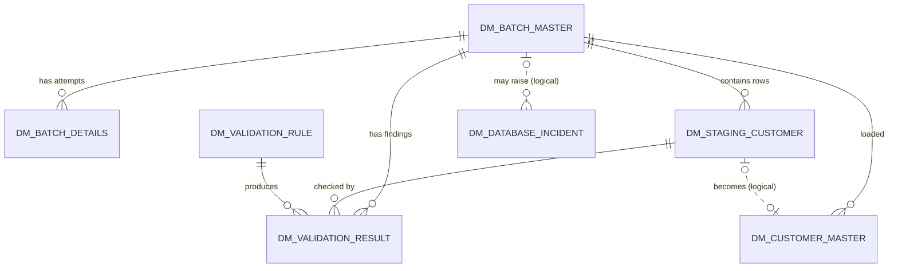

# Database Design — Phase 1

Schema `DATAMIND_AI` in pluggable database `FREEPDB1` (Oracle AI Database 26ai Free, 19c-compatible DDL).
All project tables use the `DM_` prefix. Install with `database/install_phase1.sql`.

## Entity-relationship diagram



Solid lines are enforced foreign keys. Dotted lines are logical links without a foreign key (reasons below).

## Tables

| Table | Purpose | Key rules |
|---|---|---|
| `DM_BATCH_MASTER` | One row per ingestion batch: source, lifecycle status, record counters. | Status limited to 9 lifecycle values; counters ≥ 0; end ≥ start. |
| `DM_BATCH_DETAILS` | Attempt history: one row per run of a step (UPLOAD / VALIDATE / DEDUPLICATE / PROCESS). | Unique `(BATCH_ID, STEP_NAME, ATTEMPT_NO)`. |
| `DM_STAGING_CUSTOMER` | Raw incoming customer rows plus the original JSON payload. | Unique `(BATCH_ID, SOURCE_ROW_NO)` — re-loading a file cannot duplicate rows. Payload must be valid JSON. |
| `DM_CUSTOMER_MASTER` | Clean, validated customers — the system of record. | Unique `SOURCE_STAGING_ID` — a retry can never load the same row twice. Unique `CUSTOMER_CODE`. |
| `DM_VALIDATION_RULE` | Configurable data-quality rules (REQUIRED, EMAIL, PHONE, REGEX, LENGTH, RANGE, UNIQUE, LOOKUP). | Fixed rule types, JSON config — no executable expressions. Versioned, can be deactivated. |
| `DM_VALIDATION_RESULT` | Findings: one row per (staging row, rule) outcome. | Stores `RULE_VERSION` used; status PASS/FAIL; severity ERROR/WARNING. |
| `DM_DATABASE_INCIDENT` | Captured Oracle errors: code, message, stack, backtrace, module, context. | Status OPEN → ANALYZING → RESOLVED → CLOSED. Context must be JSON. |
| `DM_AUDIT_LOG` | Who did what, to which object, when, with what result. | Standalone; status SUCCESS/FAILURE. |

## Data flow

```
file / API ──► DM_BATCH_MASTER (CREATED)
                    │
                    ├─► DM_STAGING_CUSTOMER  (raw rows, status NEW)
                    │         │
DM_VALIDATION_RULE ─┼─► DM_VALIDATION_RESULT (findings per row)
                    │         │
                    │         ▼  valid rows only
                    ├─► DM_CUSTOMER_MASTER   (clean records)
                    │
                    └─► DM_BATCH_DETAILS     (every attempt logged)

any error ──► DM_DATABASE_INCIDENT      any action ──► DM_AUDIT_LOG
```

## Design decisions

- **Idempotent retries.** Two unique keys make re-running safe: `(BATCH_ID, SOURCE_ROW_NO)` in staging and `SOURCE_STAGING_ID` in the master table.
- **No FK from master to staging.** Staging is temporary and may be archived or purged; the master table must not block that.
- **No FK from incidents to batches.** Error logging must never fail because of the data problem it is trying to record.
- **No FKs on the audit log.** Audit rows must outlive the objects they describe.
- **Correlation IDs** on batches, incidents and audit rows connect UI requests, API calls, batch work and AI analysis.
- **Identity columns** for primary keys (supported from Oracle 12c).

## Indexes

Primary and unique keys create their own indexes. Additional indexes in `database/03_indexes/01_phase1_indexes.sql` cover the remaining foreign keys and the dashboard's main filters (batch, status, severity, date). Re-evaluate with real execution plans once data volumes exist.

## Tables added in later phases

`DM_DATA_SOURCE`, `DM_DUPLICATE_GROUP`, `DM_DUPLICATE_MEMBER`, `DM_SQL_PERFORMANCE`, `DM_ANOMALY_RESULT`, `DM_AI_ANALYSIS`, `DM_AI_RECOMMENDATION`, `DM_SCHEMA_METADATA`: each is created with its module.
